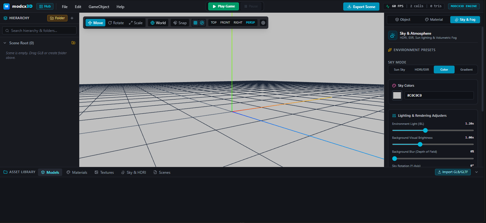
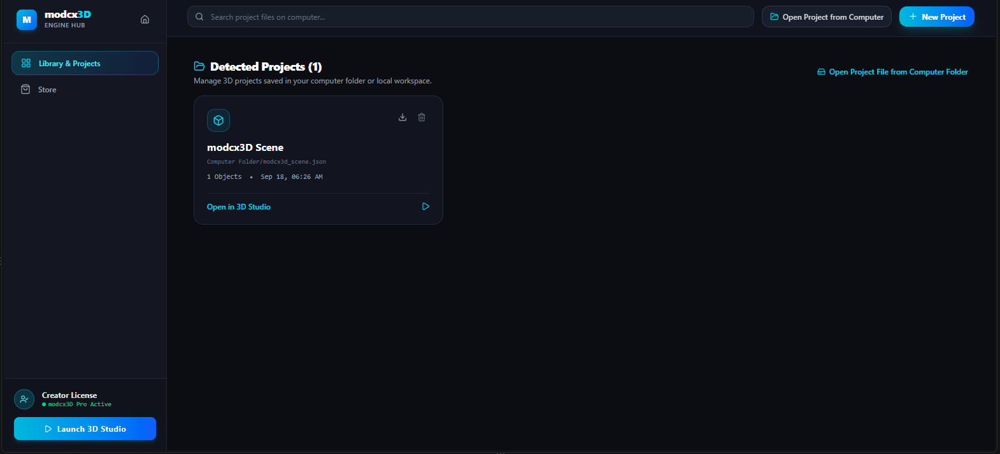

# modcx3D
### Browser-Based WebGL 3D Scene Design & Development Studio

modcx3D is a browser-based 3D development workspace designed for creating, editing, and managing WebGL game scenes directly in the browser.

Build interactive 3D environments with real-time rendering, inspect GLTF and GLB assets, create physically based rendering (PBR) materials, configure physical skies and environmental lighting, and export standalone 3D scenes.
## 01. Project Library & Workspace

Manage your 3D projects and access your creative workspace.

## 02. 3D Scene Editor

Design 3D game environments, arrange objects and edit scenes using the real-time viewport.

### Core Capabilities

- **3D Scene Design:** Create, arrange, and edit objects in a real-time 3D viewport.
- **GLTF / GLB Asset Inspection:** Import, inspect, and manage 3D assets.
- **PBR Material Editing:** Customize surface properties and material appearance.
- **Environment & Physical Skies:** Configure skies, environmental settings, and lighting.
- **Scene Management:** Organize scene objects and manage project data.
- **Real-Time Rendering:** Preview scene changes directly in the browser.
- **Scene Export:** Export standalone 3D scenes and project files.

**Create. Design. Inspect. Render. Export.**

modcx3D brings essential 3D scene creation and editing tools into one browser-based workspace.
